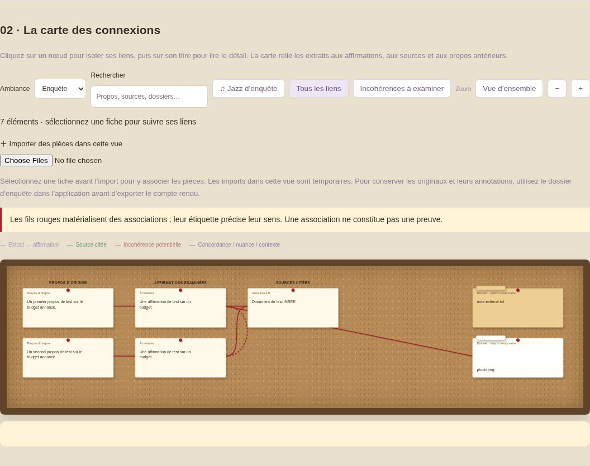

<h1 align="center">Interprète</h1>

<strong>Gardez le fil de l’interview. Retrouvez les sources. Préparez votre prochaine question.</strong>

  <a href="https://github.com/grecdel/Interprete/releases/download/v0.6.0/Interprete-0.6.0-android.apk">Télécharger pour Android</a> ·
  <a href="https://github.com/grecdel/Interprete/releases/download/v0.6.0/Interprete-0.6.0-linux-x86_64.AppImage">Télécharger pour Linux</a> ·
  <a href="docs/INSTALLATION.md">Installation</a> ·
  <a href="docs/USAGE.md">Utilisation</a>

Une **bulle discrète** ouvre un **volet latéral** : le micro, les propos à vérifier et les sources restent à portée de main. Un dossier rassemble les documents ; un tableau d’enquête aide à relire les connexions après l’échange.

Quatre matières animées : **Pastel · eau**, **Sombre · électricité violette**, **Matrix · données numériques**, **Enquête · fumée**.

*Aperçu du principe de l’interface sur Linux ; données fictives de démonstration. La disposition varie selon la plateforme et la taille d’écran.*

> **Prototype d’assistance journalistique.** Interprète propose des pistes, des sources et des relances. La rédaction garde la responsabilité du recoupement ; aucun verdict automatique n’est infaillible.

> **Nouveau dans la 0.7** : une bulle vivante qui réagit à la voix, une relance rapide avant les sources, un niveau de preuve sur chaque carte, la préparation de l’interview, la correction de la transcription et un dossier de preuves à partager. [Voir les notes de version](docs/RELEASE-0.7.0.md).

## Le volet latéral : l’essentiel pendant l’échange

Sur grand écran, le volet vise environ un quart de la largeur, avec une largeur minimale pour rester lisible. Sur téléphone, il s’adapte à l’écran. La fenêtre au-dessus des applications dépend de la plateforme et de ses permissions.

| Zone du volet | Ce que vous y faites |
| --- | --- |
| **Bulle** | Fermée, elle ouvre l’assistant et affiche la relance prête. Volet ouvert, elle démarre ou met en pause l’écoute (aussi avec Espace sur ordinateur). Sa matière respire, suit la voix et signale l’analyse. |
| **En-tête** | Accéder aux réglages et à l’archive, ou réduire le volet. Réduire le volet arrête le micro. |
| **Ambiance** | Dans les Réglages : automatique (clair ou sombre selon le système) par défaut, ou pastel, sombre, Matrix, enquête, feu. La bulle s’accorde au thème. |
| **Micro** | Écouter une interview ou un reportage diffusé près du micro. La transcription en direct tient sur une ligne, dépliable. Les options de conservation audio sont disponibles sur Android. |
| **Fil des vérifications** | Lire les affirmations examinées, leur niveau de preuve, les réserves, les sources et les questions de relance. Une relance provisoire apparaît d’abord, puis la vérification sourcée. |
| **Zone de saisie** | Vérifier une phrase, un extrait d’article ou un lien public, sans passer par le micro. |
| **Bouton « + »** | Préparer l’interview, ouvrir le dossier d’enquête, lancer une recherche OSINT ou les outils de jargon, calcul et citation. |

Les réglages et l’archive s’ouvrent depuis le volet ; le dossier de pièces dispose d’une fenêtre dédiée. Les recherches prennent plusieurs secondes : une réponse instantanée pendant chaque échange n’est pas garantie.

## Cas d’usage : préparer une relance pendant une interview

**Exemple fictif :** une personne affirme que « le budget a augmenté de 20 % ».

| Moment | Votre action | Ce qu’Interprète apporte |
| --- | --- | --- |
| **Avant** | Importer le document budgétaire, noter sa date et les passages utiles. | Un dossier consultable et recherchable, avec provenance et annotations. |
| **Pendant** | Activer le micro ou saisir la phrase entendue ; consulter le fil. | Des pistes de vérification, leurs sources et limites, puis une question à envisager. |
| **Après** | Relire la transcription, ouvrir les originaux et exporter le compte rendu. | Les propos rapprochés des analyses, des pièces et des connexions ; sur Android, le ZIP peut joindre les extraits audio conservés. |

Une relance possible : **« Comparez-vous le budget voté ou les dépenses exécutées, sur quelle période et à périmètre constant ? »**

Le calculateur peut vérifier que passer de 100 à 120 représente +20 %. Il ne démontre pas que ces montants décrivent le même budget : c’est le document original et son contexte qui permettent de le vérifier.

[Voir le parcours détaillé et d’autres usages](docs/USAGE.md).

## Les fonctions, selon votre besoin

| Besoin | Fonction | À savoir |
| --- | --- | --- |
| **Suivre un direct** | Micro, transcription et fil de vérifications | Transcription automatique à relire ; Internet nécessaire pour la transcription en ligne. |
| **Examiner un article** | Saisie de texte ou de lien public | Si l’article n’est pas accessible, coller son texte plutôt que déduire son contenu. |
| **Exploiter des documents** | Dossier local, recherche, PDF et OCR d’images | Extraction locale ; les erreurs d’OCR et les limites de taille restent à contrôler. |
| **Chercher des sources** | Huit connecteurs OSINT directs et raccourcis externes | Une notice enregistrée ne remplace pas la lecture du document complet. |
| **Comprendre une formule** | Glossaire local de jargon, calculateur et comparaison textuelle | Le glossaire reconnaît des termes connus ; il ne reformule pas toutes les phrases. |
| **Comparer des propos** | Contexte de la session et import d’archives JSON passées | Les différences de date, de périmètre et d’interlocuteur doivent être examinées. |
| **Relire l’enquête** | Compte rendu HTML, carte, recherche et sélection des liens | Les connexions sont des pistes ; une association ne constitue pas une preuve. |
| **Conserver l’audio** | Android : enregistrement local, mode hors ligne et export ZIP | Plafonds de durée 30/60/180 minutes, sous réserve de stockage et de fonctionnement du téléphone. |

## Après l’interview : le tableau d’enquête

L’archive HTML propose une carte des propos, des sources et des pièces. Le thème **enquête** apporte un tableau en liège, des dossiers, des photos façon Polaroïd et des fils rouges. Recherche, zoom et vue d’ensemble aident à retrouver les liens utiles ; l’ambiance jazzy locale reste optionnelle.

Sélectionner une fiche isole ses liens. Dans un dossier ZIP audio Android, les propos associés donnent accès aux extraits conservés. Les imports réalisés directement dans la carte autonome sont **temporaires** : utiliser le dossier d’enquête de l’application pour les conserver.

## Les sources OSINT accessibles depuis le dossier

**Crossref · data.gouv.fr · Annuaire des entreprises · Europe PMC · Wikidata · Wayback · GDELT · Open Library**

Choisir un fournisseur, saisir une requête, consulter les notices et conserver celles qui sont utiles au dossier. La requête est envoyée au fournisseur au clic ; les fichiers du dossier ne sont pas transmis automatiquement. Wayback et GDELT peuvent limiter ou refuser temporairement les requêtes.

Le [catalogue OSINT](docs/OSINT.md) distingue les connecteurs disponibles des services proposés mais non activés, notamment ceux nécessitant des accès ou licences spécifiques.

## Installer

| Votre appareil | Installation |
| --- | --- |
| **Android 8 ou plus récent** | [Télécharger l’APK 0.6](https://github.com/grecdel/Interprete/releases/download/v0.6.0/Interprete-0.6.0-android.apk), ouvrir le fichier et autoriser l’installation depuis le navigateur si demandé. Garder Android System WebView à jour. |
| **PC Linux x86_64** | [Télécharger l’AppImage 0.6](https://github.com/grecdel/Interprete/releases/download/v0.6.0/Interprete-0.6.0-linux-x86_64.AppImage), autoriser son exécution puis l’ouvrir. Une archive portable est aussi fournie dans la version GitHub. |
| **Windows, macOS, Linux ARM** | Pas d’exécutable publié et validé pour ces plateformes. Le [mode web local](docs/INSTALLATION.md#mode-web-local-windows-macos-et-linux) fonctionne avec Python ; les fonctions natives Android ne sont pas disponibles dans ce mode. |
| **iPhone / iPad** | Pas d’application iOS publiée. L’APK Android ne s’installe pas sur iOS. |

[Guide d’installation détaillé](docs/INSTALLATION.md) · [Tous les téléchargements](https://github.com/grecdel/Interprete/releases)

## Premier démarrage

1. Ouvrir **Réglages** et renseigner sa clé API OpenAI pour la transcription et les vérifications web. Un abonnement ChatGPT n’inclut pas le crédit API.
2. Autoriser le micro. Sur Android, autoriser séparément la bulle flottante si souhaité.
3. Ouvrir le volet pour écouter ou saisir une phrase ; utiliser **Dossier d’enquête** pour préparer les documents et recherches.
4. Exporter le compte rendu avant de quitter. Sur Android, choisir le ZIP pour joindre les fichiers audio conservés.

La clé n’est pas fournie dans le programme. Sur Android, sa mémorisation utilise Android Keystore. Les recherches documentaires publiques et le PDF/OCR local ne nécessitent pas cette clé.

## Limites à connaître

L’outil reste un prototype. Ni la transcription, ni l’OCR, ni les conclusions ne sont garantis exacts. Les sources originales, dates et périmètres doivent être vérifiés par la rédaction.

Les fichiers restent locaux sauf envoi explicitement déclenché. L’audio destiné à la transcription est envoyé à OpenAI ; le mode Android hors ligne conserve l’audio sans le transcrire. Le son interne des autres applications et les appels ne sont pas capturés directement.

La conservation audio longue durée et l’export ZIP audio sont propres à Android. Les durées sont des plafonds, sous réserve de stockage et de fonctionnement du téléphone. Un essai réel de trois heures reste nécessaire avant de compter sur cette durée en direct. Les imports effectués directement dans une carte autonome sont temporaires.

[Limites détaillées](docs/VERSION-0.4.md) · [Audit de sécurité](docs/SECURITY_AUDIT.md) · [Signaler une vulnérabilité](SECURITY.md) · [Développement](docs/DEVELOPMENT.md)
