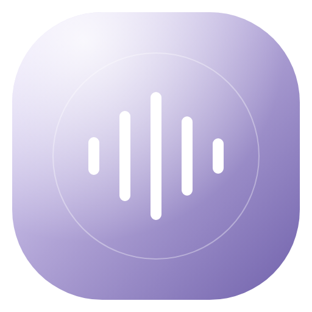
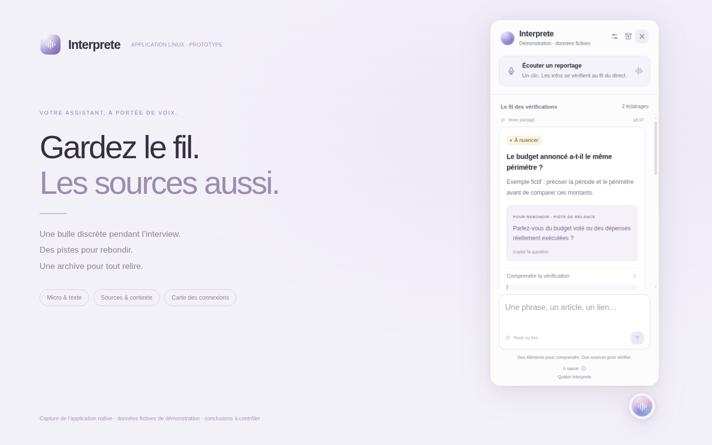
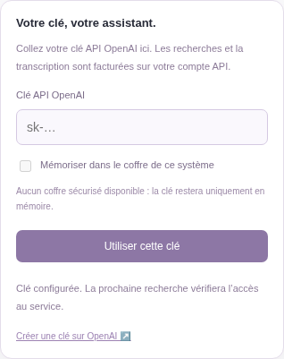
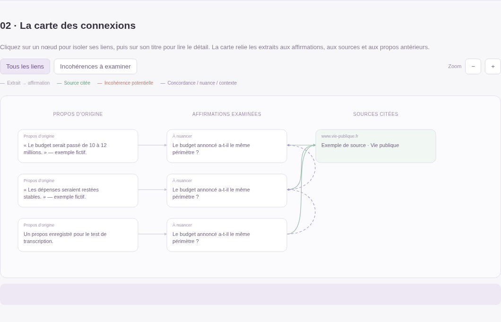

<p align="center"></p>
<h1 align="center">Interprete</h1>
<p align="center"><strong>Une bulle pendant l’interview. Des pistes pour rebondir. Une archive pour tout relire.</strong></p>
<p align="center">
  <a href="https://github.com/grecdel/Interprete/releases/latest">Télécharger pour Linux</a> ·
  <a href="docs/DESKTOP.md">Premiers pas</a> ·
  <a href="docs/DEVELOPMENT.md">Développer</a>
</p>
<p align="center">
  
  
  <a href="https://github.com/grecdel/Interprete/actions/workflows/build-linux.yml"></a>
</p>



> **Prototype expérimental.** Interprete propose des éléments à vérifier, pas une vérité garantie. Les conclusions, citations et connexions doivent être contrôlées avant une relance factuelle à l’antenne. Les captures ci-dessus et ci-dessous utilisent des **données fictives de démonstration**.

## Une application à ouvrir, simplement

Téléchargez **`Interprete-0.2.0-linux-x86_64.AppImage`** dans les [versions publiées](https://github.com/grecdel/Interprete/releases). Autorisez son exécution dans les propriétés du fichier, puis double-cliquez dessus.

Ou, dans le dossier du téléchargement :

```sh
chmod +x Interprete-0.2.0-linux-x86_64.AppImage
./Interprete-0.2.0-linux-x86_64.AppImage
```

**Python, le serveur et l’interface sont embarqués.** Vous n’avez pas à lancer un terminal, déployer un site ou configurer un environnement Codex pour l’utiliser. Une archive portable `.tar.gz` est également fournie si AppImage/FUSE n’est pas disponible.

| Pendant l’interview | Après l’interview |
| --- | --- |
| Une bulle au premier plan et un volet compact. | La transcription complète horodatée. |
| Un micro, une phrase, un article ou un lien. | Les propos exacts rapprochés des analyses. |
| Des pistes de relance avec contexte et sources. | Un compte rendu HTML et une archive JSON. |
| Des rapprochements avec les propos antérieurs. | Une carte des connexions à explorer hors ligne. |

## Votre clé, dans l’application

Au premier lancement, saisissez votre **clé API OpenAI** dans les réglages d’Interprete. La clé reste en mémoire ; sa mémorisation est proposée uniquement lorsqu’un coffre système sécurisé est disponible. Elle n’est jamais incluse dans le programme distribué.

<p align="center"></p>

La transcription audio et les recherches utilisent votre compte API OpenAI et peuvent être facturées. Un abonnement ChatGPT ne fournit pas ce crédit API. [Créer une clé](https://platform.openai.com/api-keys).

## Relire les connexions

Le compte rendu relie les extraits d’origine aux affirmations, aux sources citées et aux propos antérieurs. Sélectionnez un nœud, affichez les incohérences potentielles et retrouvez les passages concernés.



La carte reste consultable sans connexion. Seule l’ouverture des documents sources nécessite Internet. Importez une archive JSON passée pour fournir du contexte à une prochaine interview.

## Ce que cette version garantit — et ses limites

- Le serveur fonctionne **sur votre ordinateur**, avec une API locale réservée à l’application de bureau.
- L’audio est envoyé à OpenAI par extraits de 12 secondes, sur autorisation du micro. Aucun fichier audio n’est conservé. Il faut une connexion Internet.
- Les recherches prennent plusieurs secondes. Ce prototype ne garantit pas une réponse instantanée ni une latence adaptée à chaque direct.
- Une conclusion sans source associée est ramenée à **« Informations insuffisantes »**. Cela ne certifie pas les conclusions qui ont des sources.
- Les citations proposées ne sont pas automatiquement comparées mot à mot aux documents originaux. **Le recoupement journalistique reste indispensable.**
- Les connexions avec des propos passés sont des pistes : les dates, les périmètres et les interlocuteurs peuvent différer. La transcription n’identifie pas automatiquement les personnes.

Consultez le [guide de l’application Linux](docs/DESKTOP.md) pour les permissions du micro, X11/XWayland, les fichiers exportés et les données transmises.

## Construire et tester

```sh
python3 -m venv .build-venv
.build-venv/bin/pip install -r requirements-build.txt
npm ci
npx --no install-electron
.build-venv/bin/python scripts/build_backend.py
npm run dist:linux
```

La [compilation GitHub Actions](.github/workflows/build-linux.yml) produit l’AppImage, l’archive portable et leurs empreintes SHA-256. Elle vérifie aussi l’application empaquetée. Le code reste utilisable en [mode web de développement](docs/DEVELOPMENT.md).

Les tests simulent les réponses de recherche et l’audio. Ils valident le fonctionnement logiciel, **pas l’exactitude journalistique** d’une interview réelle.
